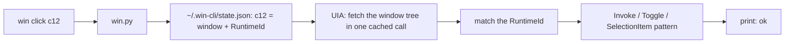

<div align="center">


## The CLI alternative to Windows MCP

#### *Screenshots are for humans. Agents get the control tree.*

**Token-lean Windows app control for AI agents, in the background, while you keep using your PC.**

[](LICENSE)
[](https://python.org)
[](https://learn.microsoft.com/windows/win32/winauto/entry-uiauto-win32)
[](selftest.py)


[Install](#-install) · [Quick start](#-quick-start) · [Commands](#-commands) · [vs Windows MCP](#-why-not-windows-mcp) · [How it works](#-how-it-works)

Sibling of [**playwrote**](https://github.com/Abedishere/playwrote-cli), the same idea for the browser.

</div>

---

Desktop-control MCPs drive Windows like a human would: screenshots, mouse moves, keystrokes. That's slow, every step costs an image or a giant state dump, and while it runs you can't touch your own mouse.

**winwrote** gives your agent a shell command, `win`. It reads an app's real control tree through Windows UI Automation, hands back short refs like `c12`, and presses buttons, ticks boxes and fills fields **without moving your mouse or taking focus**.

> [!NOTE]
> Not affiliated with Microsoft or the Windows MCP project.

## ✨ Highlights

|  |  |
|---|---|
| 🪶 **Token-lean** | The whole Windows Calculator is about 1.5k characters of text. No screenshots needed. |
| 👻 **Background by default** | Clicks, typing and selects go through UI Automation patterns and window messages. Your mouse stays yours. |
| 🛡️ **Focus guard** | If an app grabs focus anyway, `win` hands it straight back and says so. |
| ⚡ **One round trip per read** | The whole control tree comes back in a single cross-process call (UIA cache requests). |
| 🧩 **Works across UI stacks** | Tested on Win32, WinForms and UWP. Anything exposing UI Automation should work. |
| 🔁 **Batching** | `win do` runs a sequence in one tool call. |

## 🚀 Install

```bash
git clone https://github.com/Abedishere/winwrote-cli
pip install comtypes pywin32 pillow
python winwrote-cli/win.py selftest      # -> selftest ok (20/20)
```

Put a shim on your PATH so agents can call `win`:

- `win.cmd`: `@python "C:\path\to\winwrote-cli\win.py" %*`
- `win` (Git Bash): `#!/bin/sh` + `exec python "/c/path/to/winwrote-cli/win.py" "$@"`

## ⚡ Quick start

```console
$ win launch calc
ok wc0044 "Calculator" applicationframehost.exe

$ win tree calculator -i
window "Calculator":
  [c2832 text "Display is 0"]
  group "Standard operators":
    [c2847 button "Divide by"] [c2848 button "Multiply by"] [c2849 button "Minus"] [c2850 button "Plus"] [c2851 button "Equals"]
  group "Number pad":
    [c2852 button "Zero"] [c2853 button "One"] [c2854 button "Two"] ...

$ win do <<'EOF'
click c2853
click c2854
click c2848
click c2859
click c2851
EOF

$ win find calculator "Display is"
[c2870 text "Display is 84"]
```

## 🧰 Commands

| Command | What it does |
|---|---|
| `win list` | Open windows: `w<id> "title" app.exe`, with `*` marking the foreground |
| `win tree <win>` | The window's controls as an outline with refs (`-i` = refs only) |
| `win tree <win> --region <ref>` | Just one part of the window |
| `win find <win> <text>` | Find controls, e.g. `win find notepad button:Save` |
| `win click <ref>` | Clicks in the background (Invoke / Toggle / Select / Expand) |
| `win type <ref> <text> [--clear] [--append] [--enter]` | Fills a field in the background |
| `win select <ref> <option>` | Picks a combobox, list or tab item |
| `win key <win\|ref> <Enter\|ctrl+s\|...>` | Sends a key (modifiers need `--real`) |
| `win text <win>` | All visible text |
| `win wait <win> [text\|gone:text]` | Waits for a window or some text |
| `win launch <command>` | Starts an app and prints its new window |
| `win focus\|min\|max\|restore\|close <win>` | Window management |
| `win shot <win\|ref>` | Screenshot to a PNG path. Works even behind other windows |
| `win do` | Runs many commands in one call (one per line, from stdin) |

`<win>` can be the id from `win list`, part of the title, or the exe name (`notepad`, `calc`).

**`--real`** on `click`, `type` or `key` uses the actual mouse and keyboard, for the odd control with no automation support. It takes focus, and the output says so.

## 🥊 Why not Windows MCP?

| | Desktop MCPs | **winwrote** |
|---|---|---|
| How it sees the app | Screenshots and/or full state dumps | Compact control outline with refs |
| How it acts | Moves the mouse, types keys | UI Automation patterns, window messages |
| Can you use your PC meanwhile? | Not really | Yes. Focus is guarded |
| Cost per step | An image, or thousands of tokens | One line: `ok` |
| Canvas apps, games, custom-drawn UIs | ✅ via screenshots | ❌ They have no control tree. Use `--real` plus `shot` |

## 🤖 Using it from an agent

Add this to `CLAUDE.md`, `AGENTS.md` or your system prompt:

> For desktop apps, use the `win` CLI. `win list`, then `win tree <app> -i`, then act on refs with `win click`/`win type`. Only use `--real` when a background action fails.

Claude Code skill: [`SKILL.md`](SKILL.md).

## 🔬 How it works



<details>
<summary><b>More detail</b></summary>

- **Refs are UIA RuntimeIds.** They stay the same across calls while the control exists. If the app rebuilt it, the ref is matched again by type, name and AutomationId. Failing that, you get `stale ref`.
- **Classic Win32 controls** get special handling. UIA's built-in Win32 proxy focuses a control before acting on it, so edits are filled with `WM_SETTEXT` and comboboxes with `CB_SETCURSEL` plus `CBN_SELCHANGE`. No focus change.
- **Folding.** If the outline fits the budget (8000 chars by default), you get all of it. Otherwise runs of same-type siblings collapse into `…+N similar`, and `--expand <ref>` opens them.
- **Screenshots** use `PrintWindow` with `PW_RENDERFULLCONTENT`, so covered windows still capture.

</details>

## 🚧 Limits

- **Minimized UWP apps** (Calculator, Settings, the new Notepad) are suspended by Windows and expose no controls. Keep them open, even behind other windows. Classic Win32 and WinForms apps work while minimized.
- **Canvas-drawn UIs** (games, some Electron/Chromium surfaces): use [playwrote](https://github.com/Abedishere/playwrote-cli) for anything web, and `--real` plus `shot` for the rest.
- **Elevated apps** need `win` to run elevated too, which is a Windows UIPI rule.

## 📄 License

[MIT](LICENSE)

<div align="center">
<sub>Made for agents. Readable by humans.</sub>
</div>
